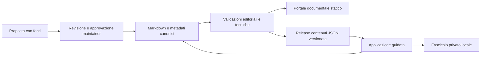

# Fasi 2, 3 e 5 - Architettura, separazione e cartelle

Stato: proposta del 2026-11-10, non implementata.

## Scelta raccomandata

Due repository indipendenti, una sola fonte dei contenuti, nessun dato di pratiche
personali nei repository pubblici. La knowledge base deve essere utile anche
senza account, applicazione o strumenti di IA.

La separazione e gia configurata nelle cartelle `cantiere-chiaro` e
`CantiereFacile`, quest'ultima collegata al remoto `cantiere-chiaro-app`.
La cartella locale chiamata `cantiere-chiaro-app` e una linea precedente con
origin documentale: non scambiarla per la destinazione dedicata.

| Responsabilita | `cantiere-chiaro` | `cantiere-chiaro-app` |
|---|---|---|
| Testi, procedure, fonti, FAQ, checklist e modelli originali | Canonico | Consumatore di release |
| Governo editoriale e approvazione delle pubblicazioni | Responsabile | Non puo promuovere bozze a verificate |
| Portale documentale e ricerca pubblica nei contenuti | Generato dalla knowledge base | Link e ricerca contestuale |
| Wizard, compilazione, diario, fascicolo privato | Solo specifiche editoriali dei percorsi | Implementazione e dati locali |
| Allegati e dati reali dell'utente | Vietati | Conservazione privata da progettare |
| Licenza | CC BY 4.0 per originali, con esclusioni | Decisione distinta; attualmente non concessa |

"Open e gratuito" e requisito della knowledge base. Per chiamare open source
anche l'app occorre una scelta esplicita di licenza del titolare, dopo controllo
dei diritti. Questo dossier non modifica licenze.

## Architettura logica



Non introdurre subito microservizi, motori vettoriali, account o backend.
Prima dimostrare qualita e manutenibilita del corpus. Un generatore statico con
supporto Markdown, metadati, ricerca e template e sufficiente per il portale;
la selezione concreta richiede un piccolo confronto sul corpus, non una riscrittura.
Il framework della futura app resta una decisione successiva: il vanilla JS
esistente non e da scartare senza un limite dimostrato.

## Cartelle del repository documentale

Struttura di arrivo proposta; non creare cartelle vuote per simulare copertura.
`docs/` rimane il contenitore canonico: i nomi richiesti non vanno duplicati alla radice.

```text
cantiere-chiaro/
  README.md
  LICENSE
  GOVERNANCE.md                  e policy esistenti
  docs/
    index.md
    orientamento/
    procedure/                  pagine canoniche delle procedure
      lavori/
      impianti/
      edilizia/
      contestazioni/
      documentazione/
      amministrazione/
      recupero-crediti/
      mediazione/
      negoziazione-assistita/
      giudice-di-pace/
      pec/
    lavori/                     indici tematici, non copie di procedure
    impianti/
    edilizia/
    contestazioni/
    mediazione/
    giudice-di-pace/
    pec/
    modelli/                    facsimili non ufficiali
    checklist/                  attivita identificabili e riutilizzabili
    guide/                      spiegazioni e glossario
    faq/
    fonti/                      schede fonti e mappa affermazioni
    ripartenza/                 questo dossier e la baseline
  templates/                    schemi editoriali; moduli legacy fino a migrazione
  schemas/                      schema metadati e contratto export, futuri
  redirects/                    vecchio percorso -> ID e nuovo percorso
  tests/
  .github/
```

I nomi delle sottocartelle distinguono argomenti, non qualifiche professionali.
Una procedura vive una sola volta; tag e indici la rendono trovabile da piu percorsi.
I moduli attuali in `templates/moduli.md` restano dove sono fino a una migrazione
approvata; successivamente `templates/` ospitera solo schemi redazionali.

## Cartelle del repository applicativo

```text
cantiere-chiaro-app/
  README.md
  index.html                    entrypoint attuale preservato durante transizione
  app.js                        implementazione attuale preservata
  styles.css
  src/                          solo dopo modularizzazione approvata
    features/
      ricerca/
      percorsi/
      documenti/
      checklist/
      fascicolo/
      cronologia/
    content/                    lettura e validazione del pacchetto editoriale
    storage/                    versioni, import/export e migrazioni locali
  public/content/               artefatti generati, mai fonte editoriale
  schemas/                      contratti importati o fissati a versione
  tests/
  .github/
```

Non trasferire le policy documentali nell'app come copie da aggiornare a mano:
collegarle e aggiungere soltanto termini, privacy, sicurezza e licenza specifici.

## Contratto di pubblicazione dei contenuti

Proposta `content-package/v1`, non API gia esistente:

- Manifesto: `schema_version`, `release_id`, `source_commit`, `generated_at`,
  `license`, `files` con percorso e SHA-256.
- Ogni elemento: `id`, `version`, `type`, `title`, `canonical_url`, `status`,
  `territory`, `last_reviewed`, `review_due`, `sources`, `sections`, `relations`.
- Checklist: `item_id` stabile per ogni voce; wizard: `node_id`, domande,
  risposte consentite, prerequisiti, esiti e criteri di arresto.
- Modelli: `template_id`, versione, campi ammessi, limiti e procedura associata.
- Ogni riferimento fra elementi usa ID, non posizione nell'array o titolo.
- Il pacchetto operativo include solo revisioni con verifica documentata e
  approvazione del maintainer; bozze possono essere visibili in area distinta,
  mai suggerite come istruzioni o modelli pronti all'uso.
- L'app fissa una release; nessun caricamento silenzioso di `main` o `latest`.
- Schema ignoto, hash errato o metadati obbligatori assenti: rifiuto del pacchetto,
  messaggio esplicito, conservazione dell'ultima copia valida e dei dati utente.
- Un riesame scaduto o un ritiro non puo essere nascosto dall'app: mantenere
  consultabile la provenienza, bloccare nuovi percorsi/generazioni sensibili.
- Aggiornamenti delle fonti e ritiri urgenti richiedono controllo dello stato al
  ritorno online. Offline mostrare data dell'ultimo controllo, non "aggiornato".
- Nessun dato del fascicolo entra nell'export editoriale o nella build pubblica.

## Mappa di transizione

| Origine attuale | Destinazione proposta | Preservazione |
|---|---|---|
| `docs/orientamento/percorso-base.md` | Stesso ID; eventuale composizione di procedure nuove | Conservare pagina di orientamento e collegamenti |
| `templates/moduli.md` | `docs/modelli/` con un ID per ciascuno dei quattro modelli | Mantenere indice/alias vecchio percorso |
| App `manuali/*.md` | Nessun originale nell'app; collegamenti canonici o generati | Backup, confronto e nota di provenienza |
| Testi `phases` in `app.js` | Dati derivati dalla release documentale | Mappare 6 fasi e 18 voci a ID stabili |
| App `manuali/index.html` | Pagina ponte verso knowledge base | Conservare URL pubblici ove possibile |
| Chiavi localStorage v1 | Storage con versione, ancora privato | Esportazione e migrazione non distruttiva |

Le righe sui manuali Markdown e sui link legacy riguardano la copia precedente.
In CantiereFacile i collegamenti canonici sono gia corretti e i Markdown
originali non sono duplicati in `manuali/`: preservare questa differenza.

## Separazione Git: vincolo operativo

Non creare un terzo repository o cambiare origin alla cieca. Confermare che
CantiereFacile resti la copia dedicata, verificare diritti, rami e stato remoto;
censire cronologia e file da non pubblicare. La copia precedente rimane intatta
come fonte storica. Eventuali riallineamenti si preparano in una copia di lavoro,
con mappa commit/provenienza. Il maintainer approva qualsiasi creazione,
riconfigurazione o pubblicazione. Nessuna riscrittura di cronologia e necessaria
o autorizzata in questa fase.